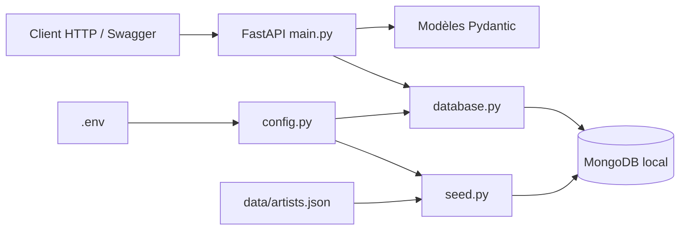
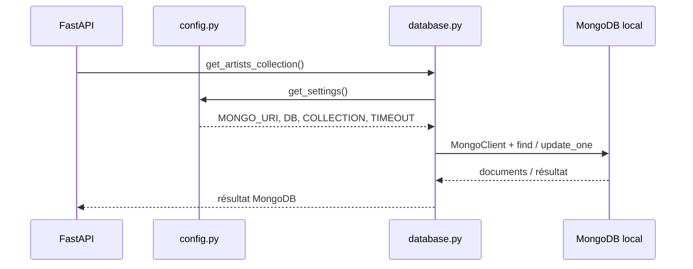
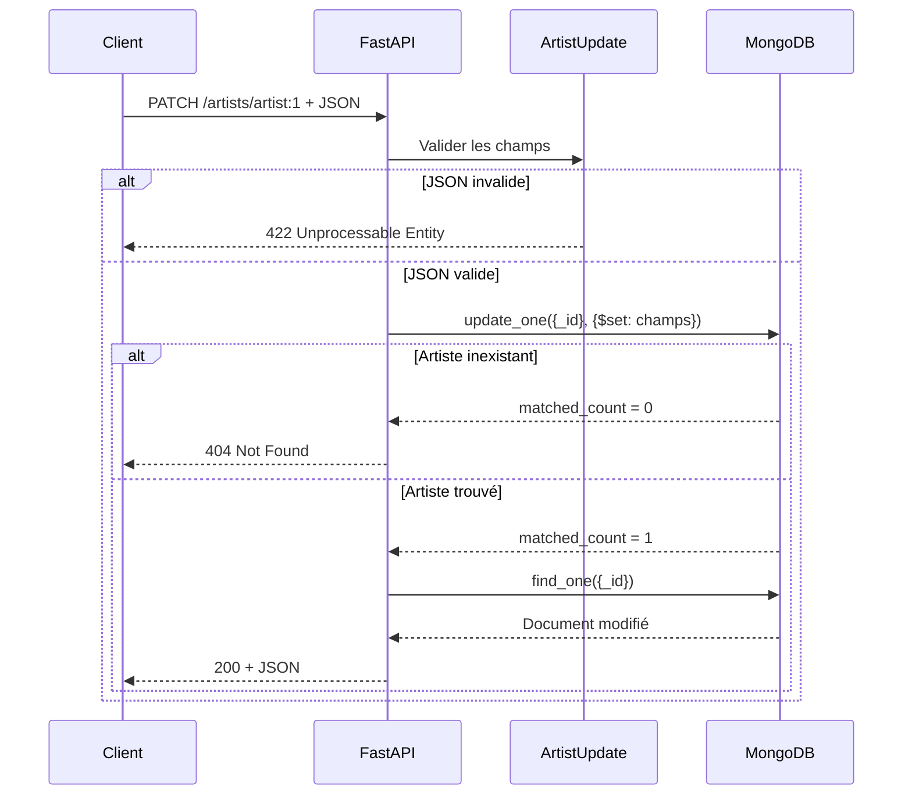

# Notes de développement — Artists API

## 1. Périmètre

L'application expose une collection MongoDB d'artistes : lecture de l'ensemble, recherche par nom ou identifiant et mise à jour d'un artiste. L'exemple GitHub utilisant des livres a servi de référence pour la démarche, pas de modèle de données.

Les 205 documents proviennent de `data/artists.json`. Exemple :

```json
{
  "_id": "artist:1",
  "last_name": "Coppola",
  "first_name": "Sofia",
  "birth_date": "1971"
}
```

Tous les `_id` du fichier sont des **chaînes** (`artist:1`, `artist:2`, ...). On ne crée pas d'`ObjectId` et on ne convertit pas les années de naissance. Certains `birth_date` sont `null` ; un artiste possède aussi un tableau `hobbies`.

## 2. Fichiers

| Fichier | Responsabilité |
| --- | --- |
| `config.py` | Lecture et validation des paramètres d'environnement |
| `database.py` | Client PyMongo partagé et accès à la collection configurée |
| `models.py` | Modèles de réponse et validation des modifications |
| `main.py` | Routes HTTP et traitement des erreurs MongoDB |
| `seed.py` | Chargement initial des données JSON, sans remplacement |
| `data/artists.json` | Documents de départ |
| `tests/` | Tests HTTP et import sur une base MongoDB simulée |

## 3. Architecture



Les routes ne connaissent ni l'adresse du serveur MongoDB ni le nom de la collection. Elles utilisent `Depends(get_artists_collection)` et peuvent donc être testées sans MongoDB réel.

## 4. Configuration `.env`

Copier `.env.example` vers `.env` avant de lancer la commande d'import ou les routes avec MongoDB.

| Variable | Exemple | Utilisation |
| --- | --- | --- |
| `MONGO_URI` | `mongodb://127.0.0.1:27017` | Adresse MongoDB pour PyMongo |
| `MONGO_DB` | `cinema` | Nom de la base |
| `MONGO_COLLECTION` | `artists` | Nom de la collection |
| `MONGO_TIMEOUT_MS` | `3000` | Délai maximal de sélection d'un serveur |
| `APP_HOST` | `127.0.0.1` | Interface d'écoute HTTP |
| `APP_PORT` | `8000` | Port de FastAPI |
| `ARTISTS_DATA_FILE` | `data/artists.json` | Fichier à importer |

`Settings` est défini dans `config.py` avec **pydantic-settings**. Une variable exportée dans le terminal est prioritaire sur le `.env`. Les paramètres sont mis en cache grâce à `lru_cache`.

Un `.env` n'est pas versionné ; `.env.example` est le modèle fourni aux étudiants.

Le port configuré est appliqué avec `python main.py`. Lancer `uvicorn main:app --reload` utiliserait les valeurs de port d'Uvicorn, sauf à fournir `--host` et `--port` explicitement.

## 5. Connexion MongoDB



`MongoClient` est créé une fois par processus, puis réutilisé. PyMongo se connecte effectivement lorsqu'une opération est exécutée. Si MongoDB ne répond pas, les routes renvoient `503 MongoDB unavailable`.

## 6. Endpoints et requêtes

### `GET /artists`

```python
collection.find({})
```

Renvoie tous les artistes. Pour l'exercice, il n'y a pas de pagination : 205 documents seulement.

### `GET /artists?name=Coppola`

```python
collection.find({
    "$or": [
        {"first_name": {"$regex": "Coppola", "$options": "i"}},
        {"last_name": {"$regex": "Coppola", "$options": "i"}},
    ]
})
```

Recherche partielle dans le prénom **ou** le nom, sans tenir compte de la casse. Le code utilise `re.escape()` afin de traiter la recherche comme du texte et non comme une expression régulière fournie par le client.

### `GET /artists?_id=artist:1`

```python
collection.find({"_id": "artist:1"})
```

Les paramètres `name` et `_id` sont cumulables : les deux conditions doivent être satisfaites.

### `GET /artists/artist:1`

```python
collection.find_one({"_id": "artist:1"})
```

Renvoie un document, ou un `404` si aucun artiste n'a cet identifiant.

### `PATCH /artists/artist:1`

```http
PATCH /artists/artist:1
Content-Type: application/json

{"birth_date": null, "hobbies": ["photo", "cinema"]}
```

```python
collection.update_one(
    {"_id": "artist:1"},
    {"$set": {"birth_date": None, "hobbies": ["photo", "cinema"]}}
)
```

Puis `find_one()` renvoie le document après modification.

`PUT` est également accepté pour rester compatible avec l'exercice, mais effectue ici **la même mise à jour partielle** que `PATCH` : il ne remplace pas le document complet.

Le modèle `ArtistUpdate` autorise `first_name`, `last_name`, `birth_date` et `hobbies`. `_id` est interdit, les champs inconnus également. Le corps ne peut pas être vide et `first_name` / `last_name` ne peuvent pas être mis à `null`. L'absence d'un champ signifie *ne pas le modifier*.

## 7. Déroulement d'une mise à jour



### Codes HTTP

| Code | Cas |
| --- | --- |
| `200` | Lecture ou mise à jour réussie |
| `404` | `_id` absent sur la route individuelle |
| `422` | JSON invalide ou champ non autorisé |
| `503` | Serveur MongoDB indisponible |

## 8. Import initial (`seed.py`)

```mermaid
flowchart TD
    A[python seed.py] --> B[Charger Settings]
    B --> C[Ping MongoDB]
    C --> D[Lire data/artists.json]
    D --> E[Pour chaque artiste]
    E --> F{_id déjà présent ?}
    F -->|Oui| G[Conserver le document]
    F -->|Non| H[Insérer avec $setOnInsert]
    G --> I{Autre artiste ?}
    H --> I
    I -->|Oui| E
    I -->|Non| J[Afficher total et nombre inséré]
```



Le script emploie `update_one(..., upsert=True)` avec `$setOnInsert` : relancer `python seed.py` est sans danger pour les données modifiées. Lors d'une première importation dans une collection vide, 205 documents sont ajoutés ; lors d'une seconde exécution, aucun document déjà présent n'est remplacé.

## 9. Tests

Les tests utilisent `pytest`, `httpx` via le `TestClient` FastAPI, et `mongomock` pour remplacer MongoDB. Ils vérifient les recherches, les modifications, les erreurs, le chargement des données et la lecture des paramètres du système.

```bash
pip install -r requirements-dev.txt
python -m pytest -q
```

**Important :** `mongomock` ne remplace pas un essai sur un vrai serveur MongoDB. Pour vérifier l'intégration locale : démarrer MongoDB, configurer `.env`, puis exécuter `python seed.py` et `python main.py`.
